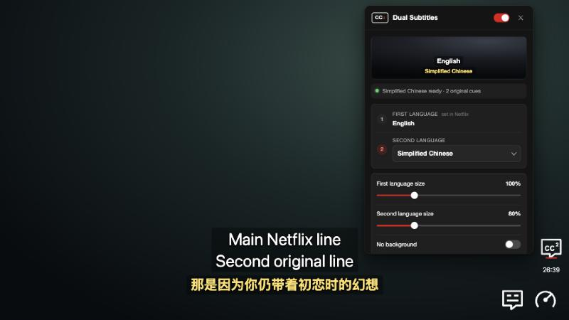

# Dual Subs

A Chrome / Edge extension that shows **two subtitle languages at once** in the Netflix player, for example English on top and Simplified Chinese underneath. It's handy for language learning or watching with someone who speaks a different language.

Both lines are Netflix's own original subtitle files. Nothing is machine-translated, and there's no server or account involved.



## Features

- Pick any second language Netflix offers for the title; the first language is whatever you choose in Netflix's own subtitle menu.
- Independent size for each language, color for the second line, line gap, bottom margin, background opacity or no background.
- **Match subtitle timing**: lines that are nearly simultaneous in both languages switch together.
- Manual delay for the second language.
- Press **C** to toggle dual subtitles on/off.
- Settings save automatically and live in your browser only.

## Install (developer mode)

The extension isn't in the Chrome Web Store, so you load it directly:

1. Download this repository (**Code → Download ZIP**) and unzip it, or `git clone` it.
2. Open `chrome://extensions` (or `edge://extensions`) and turn on **Developer mode**.
3. Click **Load unpacked** and select the `extension` folder (the one containing `manifest.json`).
4. Open or reload a Netflix title.

To update later, replace the files and click **Reload** on the extension's card, then reload Netflix once.

## Use

1. Start a Netflix title and turn on subtitles in Netflix as usual; this is your **first language**.
2. Hover the **CC²** button: above the remaining time in a window, or next to Netflix's CC icon in fullscreen.
3. Choose a **second language** in the panel. A red underline under CC² means dual subtitles are on.

You can also open the panel from Netflix's *Audio & Subtitles* menu or by clicking the extension's toolbar icon.

## How it works

| File | Role |
| --- | --- |
| `extension/page-bridge.js` | Runs in the Netflix page; reads the subtitle track list and file URLs from Netflix's player data. |
| `extension/content.js` | Loads and parses the second subtitle file and draws both lines over the video. |
| `extension/subtitles.js` | WebVTT / TTML parser and timing alignment. |
| `extension/player-controls.js` | The CC² button and the panel's placement in the player. |
| `extension/player-panel.*` | The settings panel (an isolated extension page). |
| `extension/background.js` | Fetches subtitle files from Netflix's CDN and relays panel messages. |

**Privacy:** the extension only has access to Netflix domains. Subtitle files are fetched without cookies, kept in memory, and never sent anywhere else.

## Development

Requires Node.js 20+.

```sh
npm test               # unit tests
npm run test:browser   # then open the printed URL for in-browser fixture tests
```

The browser tests run the real extension scripts against a fake Netflix player page. They don't touch real Netflix. See [TESTING.md](TESTING.md) and [CHANGELOG.md](CHANGELOG.md).

## Limitations

- Relies on Netflix's private, undocumented player internals, which can change without notice.
- Image-based subtitle tracks (used for some languages/titles) can't be shown as the second language.

## Disclaimer

Personal hobby project. Not affiliated with, endorsed by, or connected to Netflix. "Netflix" is a trademark of Netflix, Inc.
